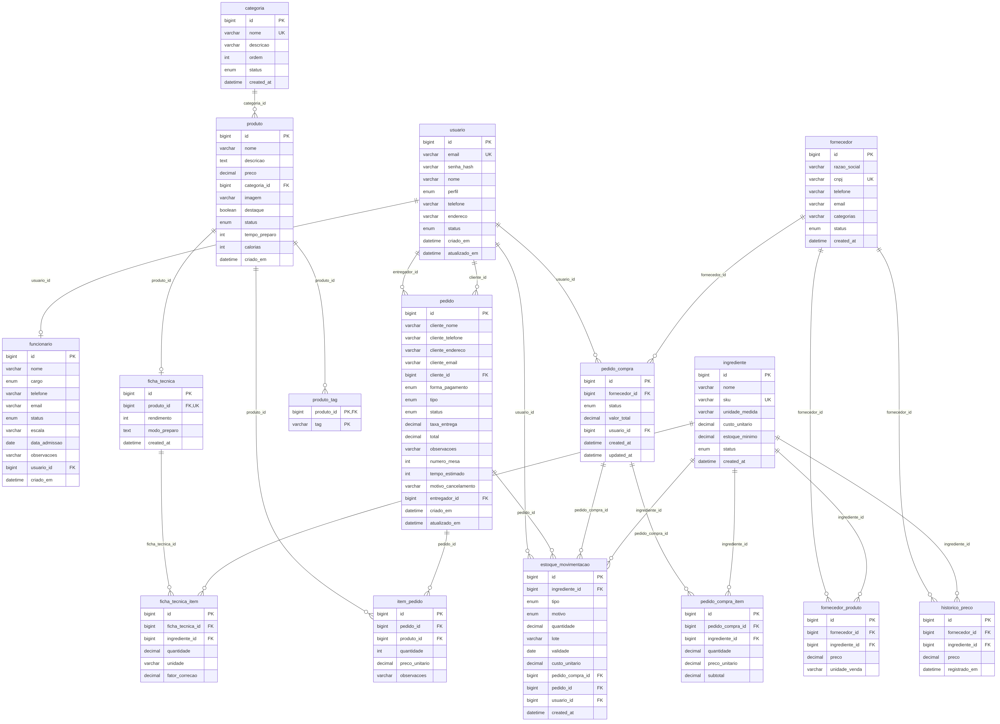

# MAKA

Sistema de delivery para uma dark kitchen: o cliente monta o pedido no site, a cozinha prepara, o entregador leva e o gerente administra cardápio, ingredientes, funcionários e relatórios.

Frontend Angular 17 + API REST em Java 17 / Spring Boot 3.5 + MySQL 8, com login JWT e migrações Flyway.

## Sistema no ar

| Parte | URL |
|---|---|
| Frontend (Vercel) | https://maka-delivery.vercel.app |
| API (Render) | https://maka-api.onrender.com |
| Swagger | https://maka-api.onrender.com/swagger-ui.html |
| Banco | MySQL 8 no Aiven |

Os planos gratuitos hibernam quando ficam parados. Na primeira visita, abra o cardápio e aguarde de 30 a 60 segundos até a API acordar.

## Usuários de teste

| Perfil | E-mail | Senha |
|---|---|---|
| Admin | admin@email.com | senha123 |
| Gerente | gerente@maka.com | 123456 |
| Cozinha | cozinha@maka.com | 123456 |
| Entregador | entregador@maka.com | 123456 |

Telas de login: `/login/manager`, `/login/kitchen` e `/login/delivery`.

## Como rodar

Requisitos: Java 17, Maven 3.9+, Node.js 18+ com npm e Docker com Docker Compose.

1. Na raiz do projeto, suba o MySQL:

   ```
   docker compose up -d
   ```

   O banco sobe vazio. As tabelas e os dados iniciais são criados pelo Flyway quando a API sobe
   (scripts em `backend/src/main/resources/db/migration`). Para zerar o banco:

   ```
   docker compose down -v
   docker compose up -d
   ```

2. Em outro terminal, suba a API:

   ```
   cd backend
   mvn spring-boot:run
   ```

   A API fica em `http://localhost:8080` e o Swagger em `http://localhost:8080/swagger-ui.html`.

3. Em outro terminal, suba o frontend:

   ```
   cd frontend
   npm ci
   npm start
   ```

   Acesse `http://localhost:4200`.

### Variáveis de ambiente

| Variável | Uso | Padrão local |
|---|---|---|
| `DB_PASSWORD` | senha do MySQL | `maka123` |
| `DB_USER` | usuário do MySQL | `root` |
| `SPRING_DATASOURCE_URL` | URL JDBC do banco | MySQL local na porta 3306 |
| `JWT_SECRET` | segredo do token JWT (8 horas de validade) | valor de desenvolvimento |
| `CORS_ALLOWED_ORIGINS` | origens liberadas no CORS | `http://localhost:4200` |

Em produção, todas são configuradas no painel do Render. Nenhum segredo vai para o repositório.

## Banco de dados



O schema é criado e versionado pelo Flyway (`V1` a `V5`). O Hibernate só valida (`ddl-auto=validate`). Mudança no banco é sempre uma migração nova; nunca se edita uma migração já aplicada.

## Funcionalidades

- **Cardápio e carrinho:** cardápio público com filtro por categoria, mostrando apenas pratos ativos.
- **Gestão:** CRUD de pratos, categorias e funcionários, com paginação e exclusão lógica.
- **Ficha técnica e custo:** ingredientes por prato, fator de correção, food cost com faixas verde, amarela e vermelha, e aviso acima de 35%.
- **Ingredientes:** CRUD paginado em `/gerente/ingredientes`, protegido para o perfil gerente.
- **Insights:** indicadores e gráficos Chart.js a partir de `GET /api/insights/resumo`.
- **Autenticação:** login com JWT de 8 horas e senhas em BCrypt; as rotas `/api/admin/**` exigem o perfil gerente.

### Contrato de ingredientes

| Método | Endpoint | Descrição |
|---|---|---|
| `GET` | `/api/admin/ingredientes?page=0&size=10` | Lista paginada, ordenada por nome (`size` máximo 100) |
| `POST` | `/api/admin/ingredientes` | Cria ingrediente |
| `PUT` | `/api/admin/ingredientes/{id}` | Atualiza ingrediente |
| `DELETE` | `/api/admin/ingredientes/{id}` | Exclui ingrediente |

O corpo de `POST` e `PUT` usa `nome`, `unidadeMedida` e `custoUnitario`. A listagem retorna uma página Spring Data com os registros em `content`.

```json
{
  "nome": "Farinha de trigo",
  "unidadeMedida": "kg",
  "custoUnitario": 6.5
}
```

## Testes

```
cd backend
mvn test
```

```
cd frontend
npm run build
```

## Estrutura

- `backend/` — API Java 17, Spring Boot e MySQL
- `frontend/` — aplicação Angular
- `docs/` — diagrama do banco (DER) e plano do projeto
- `docker-compose.yml` — MySQL para desenvolvimento
