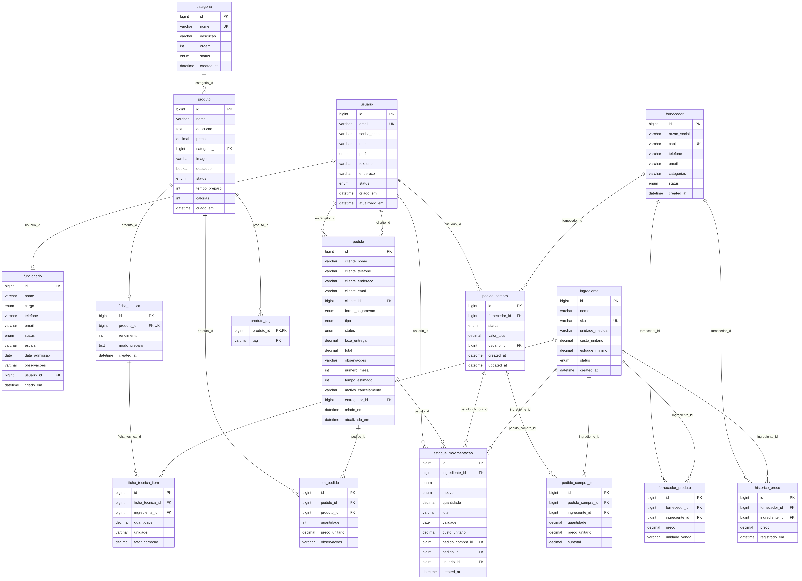

# MAKA

Sistema de delivery para uma dark kitchen: o cliente monta o pedido no site, a cozinha prepara, o entregador leva e o gerente administra cardápio, ingredientes, funcionários e relatórios.

Frontend Angular 17 + API REST em Java 17 / Spring Boot 3.5 + MySQL 8, com login JWT e migrações Flyway.

## Sistema no ar

| Parte | URL |
|---|---|
| Frontend (Vercel) | https://maka-delivery.vercel.app |
| API (Render) | https://maka-api.onrender.com |
| Swagger | https://maka-api.onrender.com/swagger-ui.html |
| Banco | MySQL 8 compatível (TiDB Cloud) |


Os planos gratuitos hibernam quando ficam parados. Na primeira visita, abra o cardápio e aguarde de 30 a 60 segundos até a API acordar.

## Usuários de teste

| Perfil | E-mail | Senha |
|---|---|---|
| Admin | admin@email.com | senha123 |
| Gerente | gerente@maka.com | 123456 |
| Cozinha | cozinha@maka.com | 123456 |
| Entregador | entregador@maka.com | 123456 |

Telas de login: `/login/manager`, `/login/kitchen` e `/login/delivery`.

## Como rodar

Requisitos: Java 17, Maven 3.9+, Node.js 18+ com npm e Docker com Docker Compose.

1. Na raiz do projeto, suba o MySQL:

   ```
   docker compose up -d
   ```

   O banco sobe vazio. As tabelas e os dados iniciais são criados pelo Flyway quando a API sobe
   (scripts em `backend/src/main/resources/db/migration`). Para zerar o banco:

   ```
   docker compose down -v
   docker compose up -d
   ```

2. Em outro terminal, suba a API:

   ```
   cd backend
   mvn spring-boot:run
   ```

   A API fica em `http://localhost:8080` e o Swagger em `http://localhost:8080/swagger-ui.html`.

3. Em outro terminal, suba o frontend:

   ```
   cd frontend
   npm ci
   npm start
   ```

   Acesse `http://localhost:4200`.

### Variáveis de ambiente

| Variável | Uso | Padrão local |
|---|---|---|
| `DB_PASSWORD` | senha do MySQL | `maka123` |
| `DB_USER` | usuário do MySQL | `root` |
| `SPRING_DATASOURCE_URL` | URL JDBC do banco | MySQL local na porta 3306 |
| `JWT_SECRET` | segredo do token JWT (8 horas de validade) | valor de desenvolvimento |
| `CORS_ALLOWED_ORIGINS` | origens liberadas no CORS | `http://localhost:4200` |

Em produção, todas são configuradas no painel do Render. Nenhum segredo vai para o repositório.

## Banco de dados



O schema é criado e versionado pelo Flyway (`V1` a `V6`). O Hibernate só valida (`ddl-auto=validate`). Mudança no banco é sempre uma migração nova; nunca se edita uma migração já aplicada.

## Funcionalidades

- **Cardápio e carrinho:** cardápio público com filtro por categoria, mostrando apenas pratos ativos.
- **Gestão:** CRUD de pratos, categorias e funcionários, com paginação e exclusão lógica.
- **Ficha técnica e custo:** ingredientes por prato, fator de correção, food cost com faixas verde, amarela e vermelha, e aviso acima de 35%.
- **Ingredientes:** CRUD paginado em `/gerente/ingredientes`, com SKU, status e estoque mínimo; exclusão lógica por status `INATIVO` (RN06).
- **Histórico de preços (RF-026):** gráfico de linhas com a evolução do preço de cada ingrediente por fornecedor, aberto pelo botão **Preços** da lista de ingredientes (`/gerente/ingredientes/:id/historico`).
- **Estoque:** entradas e saídas manuais, saldo calculado pelas movimentações, alertas no menu para saldo no mínimo ou abaixo e histórico paginado em `/gerente/estoque`.
- **Insights:** indicadores e gráficos Chart.js a partir de `GET /api/insights/resumo`.
- **Autenticação e perfis (RBAC):** cadastro e login de cliente, login da equipe, JWT de 8 horas e senhas em BCrypt. Perfis `ADMIN`, `MANAGER` (gerente), `KITCHEN` (cozinheiro), `DELIVERY` (entregador) e `CLIENTE`. Sem login a API responde 401; logado sem permissão, 403. As rotas `/api/admin/**` exigem gerente ou admin, e `/api/admin/usuarios/**` só admin.
- **Usuários internos (RF-041):** o admin cria, edita, desativa e reativa gerentes, cozinheiros e entregadores em `/gerente/usuarios`. Usuário desativado não consegue entrar (RN06).
- **Fornecedores (RF-021, RF-022):** CRUD em `/gerente/fornecedores` com CNPJ validado pelos dígitos verificadores e único (RN07), exclusão lógica e catálogo de preços por fornecedor. Cada preço novo ou alterado entra no histórico de preços (RF-026).
- **Compras (RF-023 a RF-025):** em `/gerente/compras`, cotação comparativa entre fornecedores (preço convertido para a unidade do ingrediente, com a melhor oferta destacada) e pedido de compra `RASCUNHO → ENVIADO → RECEBIDO` (ou `CANCELADO` antes de receber). Ao receber, cada item vira uma entrada `COMPRA` no estoque e o custo unitário do ingrediente passa a ser o preço pago (RN05), o que já atualiza o food cost dos pratos.

### Contrato de ingredientes

| Método | Endpoint | Descrição |
|---|---|---|
| `GET` | `/api/admin/ingredientes?page=0&size=10` | Lista paginada, ordenada por nome (`size` máximo 100) |
| `POST` | `/api/admin/ingredientes` | Cria ingrediente |
| `PUT` | `/api/admin/ingredientes/{id}` | Atualiza ingrediente |
| `DELETE` | `/api/admin/ingredientes/{id}` | Inativa logicamente o ingrediente (RN06) |
| `GET` | `/api/admin/ingredientes/{id}/historico-preco` | Série de preços por fornecedor, em ordem de data (filtro opcional `fornecedorId`) |

O corpo de `POST` e `PUT` usa `nome`, `unidadeMedida`, `custoUnitario`, `sku`, `estoqueMinimo` e `status`. `sku`, `estoqueMinimo` e `status` são opcionais na API; o mínimo padrão é zero e o status padrão é `ATIVO`.

```json
{
  "nome": "Farinha de trigo",
  "unidadeMedida": "kg",
  "custoUnitario": 6.5,
  "sku": "FAR-001",
  "estoqueMinimo": 5,
  "status": "ATIVO"
}
```

A resposta do histórico de preços é uma lista com um ponto por registro:

```json
[
  { "fornecedorId": 1, "fornecedor": "Casa de Carnes Prime Ltda", "preco": 0.0864, "registradoEm": "2026-10-17T03:10:00" }
]
```

A migração `V6` insere preços de exemplo dos últimos 28 dias para que o gráfico tenha dados na demonstração.

### Contrato de estoque

| Método | Endpoint | Descrição |
|---|---|---|
| `GET` | `/api/admin/estoque/saldos` | Saldo atual dos ingredientes ativos e contagem de alertas |
| `GET` | `/api/admin/estoque/movimentacoes?page=0&size=20` | Histórico de movimentações (máximo 100 por página) |
| `POST` | `/api/admin/estoque/entradas` | Registra entrada manual com motivo `AJUSTE` |
| `POST` | `/api/admin/estoque/saidas` | Registra saída manual com motivo obrigatório |

Saídas manuais aceitam `DESPERDICIO`, `VENCIMENTO`, `QUEBRA` ou `USO_INTERNO`; não podem deixar saldo negativo. O saldo é calculado como entradas e estornos menos saídas. As colunas necessárias já existem na migração V3.

### Contrato de usuários internos (só ADMIN)

| Método | Endpoint | Descrição |
|---|---|---|
| `GET` | `/api/admin/usuarios?page=0&size=10` | Lista paginada da equipe (clientes não aparecem) |
| `POST` | `/api/admin/usuarios` | Cria usuário: `{ username, email, password, role }` com `role` = `manager`, `kitchen` ou `delivery` |
| `PUT` | `/api/admin/usuarios/{id}` | Atualiza nome e perfil; `password` opcional troca a senha |
| `PATCH` | `/api/admin/usuarios/{id}/status` | `{ "status": "ATIVO" }` ou `{ "status": "INATIVO" }` |
| `DELETE` | `/api/admin/usuarios/{id}` | Desativa (exclusão lógica, RN06) |

### Contrato de fornecedores

| Método | Endpoint | Descrição |
|---|---|---|
| `GET` | `/api/admin/fornecedores?busca=&status=&page=0&size=10` | Lista paginada; `busca` procura na razão social e no CNPJ |
| `GET` | `/api/admin/fornecedores/ativos` | Lista curta dos fornecedores ativos (selects) |
| `POST` / `PUT` | `/api/admin/fornecedores[/{id}]` | `{ razaoSocial, cnpj, telefone, email, categorias, status }`; CNPJ inválido 400, repetido 409 |
| `PATCH` | `/api/admin/fornecedores/{id}/status` | Ativa ou inativa |
| `DELETE` | `/api/admin/fornecedores/{id}` | Inativa (exclusão lógica) |
| `GET` | `/api/admin/fornecedores/{id}/catalogo` | Catálogo com preço por unidade de venda e por unidade do ingrediente |
| `POST` / `PUT` | `/api/admin/fornecedores/{id}/catalogo[/{itemId}]` | `{ ingredienteId, preco, unidadeVenda }` (`g`, `kg`, `ml`, `L`, `un` ou a unidade do ingrediente) |
| `DELETE` | `/api/admin/fornecedores/{id}/catalogo/{itemId}` | Tira o item do catálogo (o histórico de preços fica) |

### Contrato de compras

| Método | Endpoint | Descrição |
|---|---|---|
| `GET` | `/api/admin/compras/cotacao?ingredienteIds=1,2` | Cotação comparativa (sem parâmetro: todos os ingredientes com oferta) |
| `GET` | `/api/admin/compras?status=&fornecedorId=&page=0&size=10` | Pedidos de compra, mais recentes primeiro |
| `GET` | `/api/admin/compras/{id}` | Detalhe com itens |
| `POST` | `/api/admin/compras` | Cria rascunho: `{ fornecedorId, itens: [{ ingredienteId, quantidade, precoUnitario? }] }` |
| `PUT` | `/api/admin/compras/{id}` | Edita (só rascunho) |
| `PATCH` | `/api/admin/compras/{id}/enviar` | `RASCUNHO → ENVIADO` |
| `PATCH` | `/api/admin/compras/{id}/receber` | `ENVIADO → RECEBIDO`, corpo opcional `{ lote, validade }`: entrada no estoque e custo do ingrediente atualizado |
| `PATCH` | `/api/admin/compras/{id}/cancelar` | `RASCUNHO` ou `ENVIADO → CANCELADO` |

A quantidade dos itens é na unidade do ingrediente (a mesma do estoque). Sem `precoUnitario`, vale o preço do catálogo convertido para essa unidade (ex.: R$ 78,00/kg vira R$ 0,0780/g). O total é sempre calculado no servidor. Transição de status inválida devolve 409; ingrediente fora do catálogo, inativo ou repetido devolve 422.

## Testes

```
cd backend
mvn test
```

```
cd frontend
npm run build
```

## Estrutura

- `backend/` — API Java 17, Spring Boot e MySQL
- `frontend/` — aplicação Angular
- `docs/` — diagrama do banco (DER) e plano do projeto
- `docker-compose.yml` — MySQL para desenvolvimento
